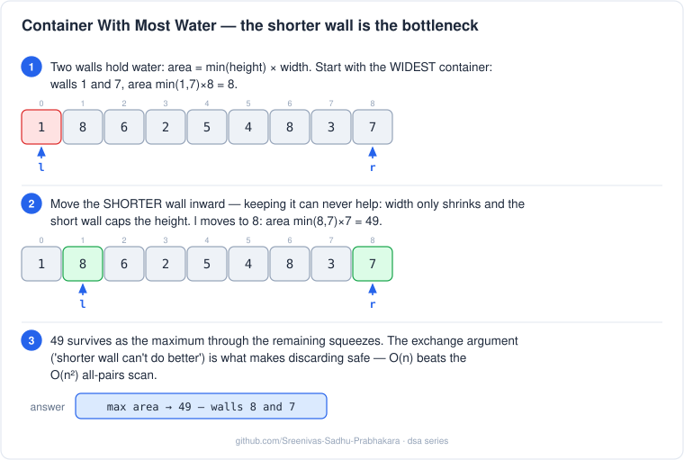

# Container With Most Water

> NeetCode 150 · Two Pointers · Blind 75 — start widest, then always abandon the shorter wall: the only exchange that can beat the current area. Go, stdlib only, tested.

## Problem

Vertical lines at integer positions; pick two so the water between them (width × shorter height) is maximal. Not Trapping Rain Water (dsa-040) — here only two walls matter and the terrain between is ignored.

## Approach

Begin with the widest container and converge. The proof obligation is why moving the *shorter* pointer is safe: keeping it while shrinking width can never improve — the height is capped by that shorter wall, and width only decreases — so every container using it at this width-or-less is dominated by the one just measured. Discarding it loses nothing; each step retires one wall, giving linearity. This is the cleanest example of a two-pointer *exchange argument* (as opposed to the sum-steering of Two Sum II), which is why the list keeps both neighbors.

**Complexity:** O(n) time, O(1) space.

## Visual walkthrough

Read the picture top to bottom — each numbered frame is one moment of the algorithm
running on this repo's test example.

## Run

    go test ./...   # verify
    go run .        # demo

---

Part of a 275-repo DSA series in Go — Striver's SDE Sheet (dsa-001–191) plus the NeetCode 150 / Blind 75 additions (dsa-192–275), stdlib only, every solution tested. Browse: [`dsa-*` repos](https://github.com/Sreenivas-Sadhu-Prabhakara?tab=repositories&q=dsa-&type=source).
